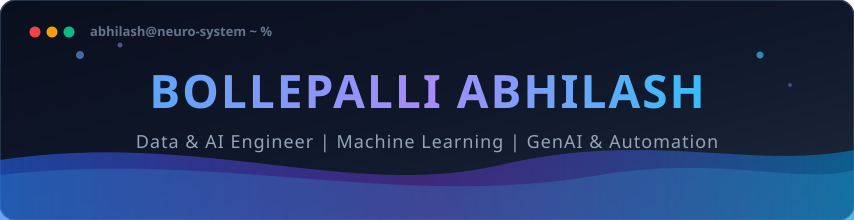

<a name="top"></a>

<!-- HERO BANNER (Hosted directly in repository for 100% reliable rendering) -->
<p align="center">
  
</p>

<!-- DYNAMIC TYPING SVG SUBTITLE -->
<div align="center">
  <a href="https://git.io/typing-svg">
    
  </a>
</div>

<!-- QUICK NAV & PROFILE VIEWS BADGES -->
<p align="center">
  <code>Abhilash@GitHub:~$ cat README.md</code>
  <br/><br/>
  <a href="#about-me"><b>About</b></a> • 
  <a href="#tech-stack"><b>Tech Stack</b></a> • 
  <a href="#featured-projects"><b>Projects</b></a> • 
  <a href="#experience"><b>Experience</b></a> • 
  <a href="#github-stats"><b>Stats</b></a> • 
  <a href="#certifications"><b>Certifications</b></a> • 
  <a href="#connect"><b>Contact</b></a>
</p>

<!-- DUAL BACKUP PROFILE VIEWS COUNTER (Reliable Markdown Badges) -->
<p align="center">
  
  &nbsp;
  
  &nbsp;
  
</p>

<!-- SOCIAL & CONTACT BADGES -->
<div align="center">
  <a href="mailto:abhilashshiva.b@gmail.com">
    
  </a>
  <a href="https://www.linkedin.com/in/bollepalli-abhilash-52619926b/" target="_blank">
    
  </a>
  <a href="https://github.com/abhilashshiva" target="_blank">
    
  </a>
  <a href="tel:+919030422529">
    
  </a>
</div>

<br/>

---

<a name="about-me"></a>
## 💡 About Me

```javascript
const abhilash = {
    pronouns: "He/Him",
    location: "Hyderabad, Telangana, India",
    education: {
        degree: "B.Tech in Computer Science (AIML)",
        institution: "MLR Institute of Technology",
        cgpa: "8.1 / 10.0",
        period: "2022 - 2026"
    },
    currentRole: "AI Developer @ Pulsus Healthtech",
    leadership: "Former Chief Operating Officer (COO) @ MLRIT CIE",
    passions: [
        "Data Engineering & High-Yield Web Scraping",
        "Generative AI & LLM Workflow Automation",
        "Root-Cause Diagnostics & Market Intelligence",
        "Full-Stack AI Application Development"
    ],
    motto: "Turn raw data into decisive action; turn intelligent models into real-world products."
};
```

* 🚀 **Data & AI Engineer** with industry experience turning raw, chaotic data into clean actionable insights and enterprise-grade AI tools.
* 🔍 **Root-Cause Investigator:** Discovered core market and company bottlenecks in 42 days at **Pulsus Healthtech** using automated data scraping and advanced exploratory diagnostics.
* 🤖 **Workflow Automator:** Architected custom multi-agent automations utilizing **Claude, Gemini, Grok, and Llama** for enterprise clients across healthcare, retail, and edtech.
* 🌐 **Full-Lifecycle Builder:** Conceived, coded, and deployed production-grade applications live on the **Google Play Store**, **App Store**, and university campuses.
* 🎓 **Leadership Track Record:** Former COO at MLRIT CIE — managed operations, brought in 40% of institutional clients, secured 60% of annual revenue, and hosted Telangana's first VR/AR innovation summit.

---

<a name="tech-stack"></a>
## 🛠️ Tech Stack & Arsenal

### 💻 Languages & Environments
<p align="left">
  
  
  
  
  
  
  
</p>

### 🧠 Data Science, Analytics & Machine Learning
<p align="left">
  
  
  
  
  
  
  
  
</p>

### 🤖 Generative AI, LLMs & Automation
<p align="left">
  
  
  
  
  
  
  
  
</p>

### 🌐 Web, Cloud & Tooling
<p align="left">
  
  
  
  
  
  
  
  
</p>

---

<a name="featured-projects"></a>
## 🚀 Featured Projects

| Project | Tech Stack | Status / Deployment | Key Highlights |
| :--- | :--- | :--- | :--- |
| **Food Detecto App** | `React.js` `Bootstrap` `Java` `Python` `Google Cloud` | 📱 [Live on App Store & Play Store](#) | • Conceptualized from an influencer audience-retention need into an active startup.<br>• Built scalable backend pipelines and cross-platform mobile architecture.<br>• Successfully deployed and serving live users. |
| **EDMIT – Educational Management System** | `React.js` `Node.js` `Supabase` `PostgreSQL` | 🏫 [Live for MLRIT](#) | • Role-based institutional platform eliminating manual campus paperwork.<br>• Digitized end-to-end fee payments, student records, and course registrations.<br>• Secure real-time access controls and audit logging. |
| **Studport – Placement & Networking Platform** | `PHP` `WordPress` `MySQL` `XAMPP` | 💼 [Live Project](#) | • Centralized placement portal connecting students with hiring recruiters.<br>• Automated resume upload, parsing, and candidate filtering.<br>• Elevated recruitment visibility across academic cohorts. |

---

<a name="experience"></a>
## 💼 Experience & Leadership

```yaml
- role: "AI Developer"
  company: "Pulsus Healthtech"
  timeline: "Jul 2026 - Present"
  location: "Hyderabad, India"
  impact:
    - "Ingested, scraped, and structured comprehensive market & enterprise datasets to diagnose 6-month performance declines."
    - "Isolated company-wide root cause in 42 days with statistical certainty."
    - "Architected and delivered data-backed corrective automated workflows utilizing cutting-edge AI tools."

- role: "Data & AI Engineer"
  company: "Bryte"
  timeline: "Aug 2025 - Jun 2026"
  location: "Hyderabad, India"
  impact:
    - "Analyzed raw client datasets to isolate critical business operational bottlenecks."
    - "Engineered customized AI solutions and agentic automations for Aqua10, Vydhya Hospitals, and Food Detecto."
    - "Delivered production models with ~80% accuracy tailored to strict operational metrics."

- role: "Chief Operating Officer (COO)"
  company: "MLRIT Centre for Innovation & Entrepreneurship (CIE)"
  timeline: "Jan 2025 - Dec 2025"
  location: "Hyderabad, India"
  impact:
    - "Directed strategic sponsorships and promotions, generating 40% of institutional clients."
    - "Secured 60% of CIE's operational revenue for the 2025 academic fiscal year."
    - "Spearheaded national innovation programs and organized Telangana's 1st AR & VR Summit."
```

---

<a name="github-stats"></a>
## 📊 GitHub Analytics & Activity

<div align="center">
  
  
</div>

<div align="center">
  
</div>

---

<a name="certifications"></a>
## 📜 Honors & Certifications

- 🏅 **CISCO:** Data Analytics Essentials *(Nov 2024)*
- 🏅 **IBM:** Python for Data Science *(Aug 2023)*
- ☁️ **Google Cloud:** Cloud Computing Foundations & Generative AI Pathways *(Oct 2023)*
- ☕ **NPTEL (IIT):** Data Structures and Algorithms with Java *(Jul - Oct 2024)*

---

<a name="connect"></a>
## 🤝 Let's Connect & Collaborate!

I'm always excited to discuss **Data Engineering pipelines**, **Autonomous AI Agents**, **GenAI integrations**, or startup ideas.

<p align="center">
  <a href="mailto:abhilashshiva.b@gmail.com"></a>&nbsp;
  <a href="https://www.linkedin.com/in/bollepalli-abhilash-52619926b/"></a>&nbsp;
  <a href="https://github.com/abhilashshiva"></a>
</p>

<p align="center">
  <a href="#top">⬆️ <b>Back to Top</b></a>
</p>

<p align="center">
  
</p>
